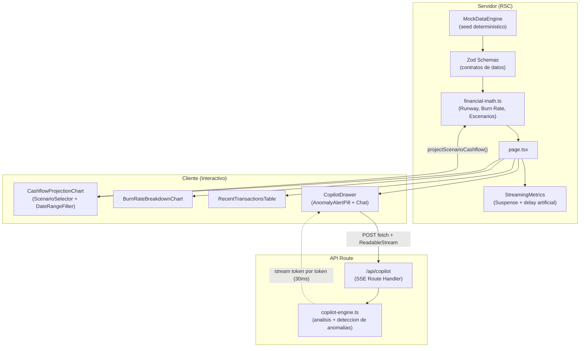

# Financial Stream Dashboard

Dashboard financiero de alto rendimiento con streaming SSE, escenarios de tesoreria en tiempo real y un AI Copilot con analisis financiero conversacional. Construido con Next.js 15 (App Router) y React 19, cero configuracion requerida: corre con datos mock deterministicos desde el primer `npm run dev`.

[](https://vercel.com/new/clone?repository-url=https://github.com/velinex/financial-stream-dashboard-core)


---

## Caracteristicas

- **Metricas financieras con streaming progresivo**: KPIs (MRR, Runway, Net Burn Rate, Saldo de Caja) renderizados como React Server Components dentro de un limite `Suspense`, con skeletons de dimensiones identicas (CLS 0.000).
- **Simulador de escenarios en tiempo real**: switch Base / Optimistic (Best) / Pessimistic (Worst) que recalcula las proyecciones de flujo de caja en el cliente, sin round-trip al servidor.
- **Grafico de flujo de caja interactivo**: proyeccion a 30/60/90 dias con Recharts, saldo, cobranzas y egresos.
- **Desglose de quema por categoria**: barras horizontales con el gasto operativo del ultimo mes cerrado.
- **Tabla de transacciones recientes**: filtro por tipo (ingresos/egresos) y paginacion client-side.
- **AI Copilot Drawer**: panel lateral con chat conversacional que consume un endpoint SSE (`/api/copilot`) con streaming real palabra por palabra, deteccion de anomalias financieras y sugerencias rapidas de auditoria.
- **Dark / Light mode**: tema persistente en `localStorage`, sin parpadeo (`suppressHydrationWarning` + script inline de inicializacion).
- **Motor de datos deterministico**: `MockDataEngine` con seed configurable, 12 meses de historial contable y 90 dias de proyeccion, sin credenciales externas.

---

## Stack Tecnologico

| Capa | Tecnologia |
| :--- | :--- |
| Framework | Next.js 15 (App Router), React 19 |
| Lenguaje | TypeScript 5 (`strict: true`, cero `any`) |
| Estilos / UI | Tailwind CSS v3, primitivas propias estilo Shadcn UI (Radix Primitives), Lucide React |
| Graficos | Recharts |
| Validacion de esquemas | Zod v3 |
| Streaming IA | Server-Sent Events nativo sobre Next.js Route Handlers |
| Testing | Vitest + React Testing Library |

---

## Arquitectura de Datos y Componentes



---

## Escenarios de Tesoreria

| Escenario | Cobranzas | Costos | DSO |
| :--- | :--- | :--- | :--- |
| **Base** | 100% de contratos recurrentes | Gastos proyectados promedio | Sin cambios |
| **Optimistic (Best)** | +20% de nuevos cierres | Sin cambios | -10 dias (cobranza anticipada) |
| **Pessimistic (Worst)** | -25% en ingresos variables | +10% en infraestructura | +30 dias (retraso de cobranza) |

El cambio de escenario recalcula toda la curva de flujo de caja en memoria (`projectScenarioCashflow`), sin parpadeo de pantalla.

---

## AI Copilot Financiero

El endpoint `POST /api/copilot` recibe `{ messages, currentMetrics, selectedScenario }`, analiza el estado financiero recibido (MRR, Runway, Net Burn Rate, Saldo de Caja) y detecta anomalias (runway critico, burn rate elevado, saldo proyectado negativo). La respuesta se transmite como `text/event-stream` con latencia artificial de 30ms por token, replicando la experiencia de un LLM en streaming sin requerir ninguna API key.

Para conectar un proveedor de IA real (OpenAI, Anthropic, etc.), instala el SDK correspondiente (por ejemplo `@ai-sdk/openai`) y sustituye la generacion de `analysisText` en `src/app/api/copilot/route.ts` por una llamada a `streamText` del Vercel AI SDK, manteniendo el mismo contrato de eventos SSE.

---

## Instalacion y Desarrollo Local

```bash
npm install
npm run dev
```

Abre [http://localhost:3000](http://localhost:3000). No se requiere ninguna variable de entorno ni API key: el `MockDataEngine` genera el dataset completo en el primer render.

### Comandos disponibles

```bash
npm run dev         # servidor de desarrollo
npm run build        # build de produccion
npm run start         # servidor de produccion (requiere build previo)
npm run lint          # ESLint (flat config, next/core-web-vitals)
npm run typecheck     # tsc --noEmit (TypeScript estricto)
npm run test          # Vitest (unit + component tests)
```

---

## Despliegue en Vercel

1. Sube este repositorio a GitHub (o tu proveedor Git preferido).
2. Haz clic en el boton **Deploy with Vercel** al inicio de este README, o importa el repositorio manualmente desde el dashboard de Vercel.
3. No se requiere configurar variables de entorno para la demo (el copiloto financiero funciona en modo mock desde el primer despliegue).
4. Framework Preset: `Next.js` (autodetectado). Build Command: `next build`. Output: gestionado automaticamente por el adaptador de Vercel.

Tambien puedes desplegar con la CLI:

```bash
npm install -g vercel
vercel --prod
```

---

## Estructura del Proyecto

```text
src/
├── app/
│   ├── api/copilot/route.ts      # Endpoint SSE del AI Copilot
│   ├── layout.tsx                # Root layout, fuentes, ThemeProvider
│   ├── page.tsx                  # Dashboard principal (RSC + Suspense)
│   └── globals.css               # Tokens de diseno (dark/light)
├── components/
│   ├── dashboard/                # Header, KPIs, filtros, tabla de transacciones
│   ├── charts/                   # Cashflow projection y burn rate breakdown (Recharts)
│   ├── ai-drawer/                # Copilot Drawer, chat streaming, anomaly badge
│   └── ui/                       # Primitivas estilo Shadcn (button, card, badge, drawer, dialog)
├── lib/
│   ├── schemas.ts                # Contratos Zod
│   ├── mock-engine.ts            # Generador deterministico de datos financieros
│   ├── financial-math.ts         # Runway, Net Burn Rate, proyeccion de escenarios
│   ├── copilot-engine.ts         # Analisis financiero y deteccion de anomalias
│   └── utils.ts                  # Helper cn() para clases Tailwind
└── types/index.ts                # Re-exportacion de tipos publicos
tests/
├── financial-math.test.ts
├── mock-engine.test.ts
└── kpi-metric-card.test.tsx
```
